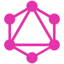

> Finding my way in the open source jungle.
>
> Junior div :-b.
>
> - [x] It’s not a bug, it’s an undocumented feature
> - [x] Spending 6 hours on a semicolon ;
>
> The C++ obsession & optimzations.
>
> - [x] Managing memory manually because I don't trust myself
> - [x] Optimizing code that doesn't even work yet
>
> Pro just LLM it.
>
> - [x] Confidence: -100% | AI Hallucinations: +100%
> - [x] Outsourced my last two brain cells to an LLM

### Tech Stack

<table rules="none" frame="void">
  <tr>
    <td width="320" valign="top">
      
      
      
    </td>
    <td width="320" valign="top">
      
      
      
      
    </td>
    <td width="320" valign="top">
      
      
      
      
    </td>
    <td width="320" valign="top">
      
      
      
    </td>
  </tr>

  <tr>
    <td width="320" valign="top">
      
      
      
      
      
    </td>
    <td width="320" valign="top">
      
      
      
      
       
      
      
    </td>
    <td width="320" valign="top">
      
      
      
      
    </td>
    <td width="320" valign="top">
      
      
      
      
       
      
      
    </td>
  </tr>

  <tr>
    <td width="320" valign="top">
      
      
      
    </td>
    <td width="320" valign="top">
      
      
      
      
      
    </td>
    <td width="320" valign="top"></td>
    <td width="320" valign="top"></td>
  </tr>
</table>

 

### Language Statistics & Achievements

  
  

 

  

    
  

  <table rules="none" frame="void">
    <tr>
      <td width="220" valign="top">
         
        
      </td>
      <td width="1060" valign="top">
          
        
        
        
        
        
        
        
        
        
        
        
        
        
        
        
        
        
        
        
        
        
        
        
        
        
        
        
        
        
        
        
        
        
        
        
        
        
        
        
        
        
        
        
        
        
        
        
        
      </td>
    </tr>
  </table>

  

    
  

  

    &nbsp;
    
     
    &nbsp;
    
  

