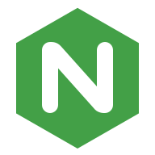
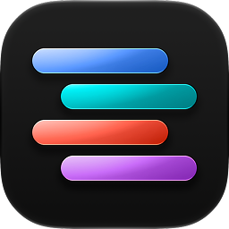
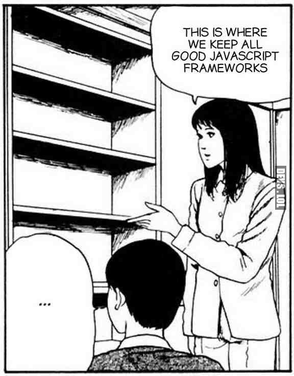
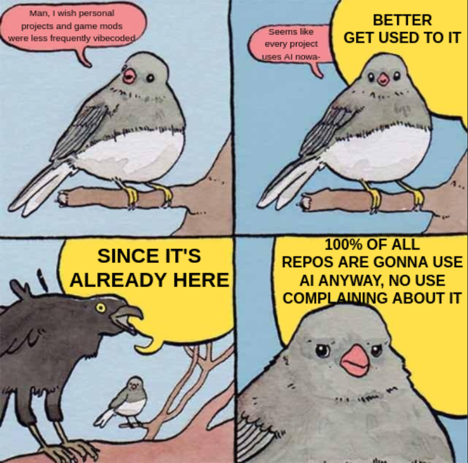
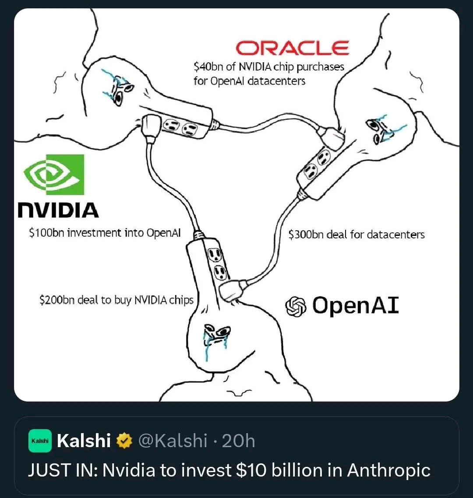
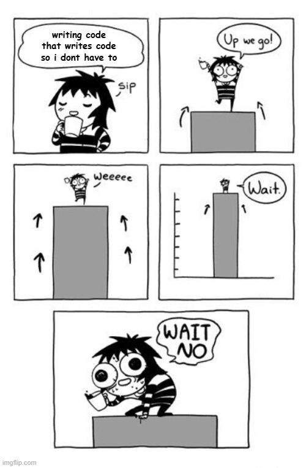

> Finding my way in the open source jungle. A-and life.
>
> Junior div. 
>
> - [x] It’s not a bug, it’s an undocumented feature
> - [x] Spending 6 hours on a semicolon ;
>
> The C++ obsession & optimzations.
>
> - [x] Managing memory manually because I don't trust myself
> - [x] Optimizing code that doesn't even work yet
>
> Pro just LLM it.
>
> - [x] Confidence: -100% | AI Hallucinations: +100%
> - [x] Outsourced my last two brain cells to an LLM

> [!IMPORTANT]
> *"There is more to life than simply increasing its speed."*
> 
> **~Mahatma Gandhi**

<!-- animated icons from [https://thanhnguyxnorg.github.io/Techstack-Studio/?plate=0]  -->

### Tech Stack

<!-- Row 1: Compiled, Interpreted, Frontend -->

  
  
  

  
  
  
  

  
  
  
  

<!-- Row 2: Backend, Databases, Cloud & Ops -->

  
  
  

  
  
  
  
  

  
  
  
  
  
  
  

<!-- Row 3: Version Control, Tools & IDEs, E-Commerce, AI Agents -->

  
  
  
  

  
  
  
  
  
  
  

  
  
  

  
  
  
  
  

 

### Language Statistics & Achievements

  
  

 

#### Pieces of myself

  
 Next (aka never)

<!-- Creative & 3D -->

  
  

<!-- Discovering -->

   

  
  
  
  
  
  
  
  
  
  
  
  
  
  
  
   

  
  
  
  
  
  
  
  
  
  
  
  
   

  
  
  
  
  
  
   

  
  
  
  
  
  
  
  
  
  
  
  
  
  
  
  
  

 

  
Quote

> *"To have faith is to trust yourself to the water."*
> 
> **~Alan Watts**

> *"To be yourself in a world that is constantly trying to make you something else is the greatest accomplishment."*
> 
> **~Ralph Waldo Emerson**

> *"Be the change that you wish to see in the world."*
> 
> **~Mahatma Gandhi**

> *"Pain is inevitable. Suffering is optional."*
> 
> **~haruki murakami**

 

  
༼∵༽ ༼⍨༽ ༼⍢༽ ༼⍤༽

  

  
  

  

    &nbsp;
    
     
    &nbsp;
    
     
    &nbsp;
    
  

       

  <h3 > </h3>
  

  &nbsp;
  
   
  &nbsp;
  
   
  &nbsp;
  
  

    

  

    
 

    

     >
    

  

